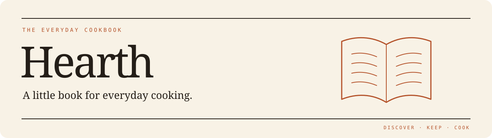
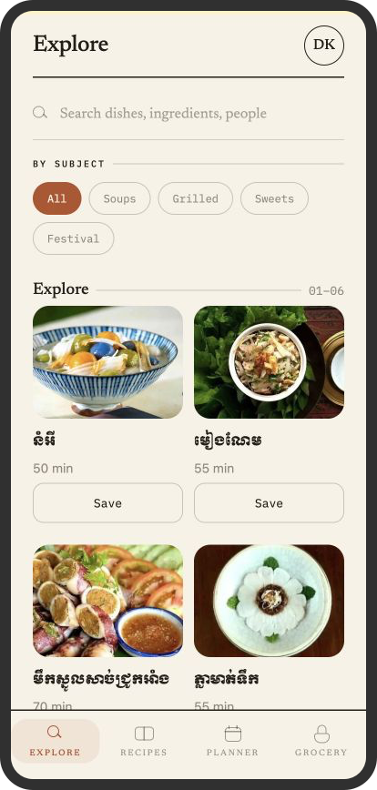
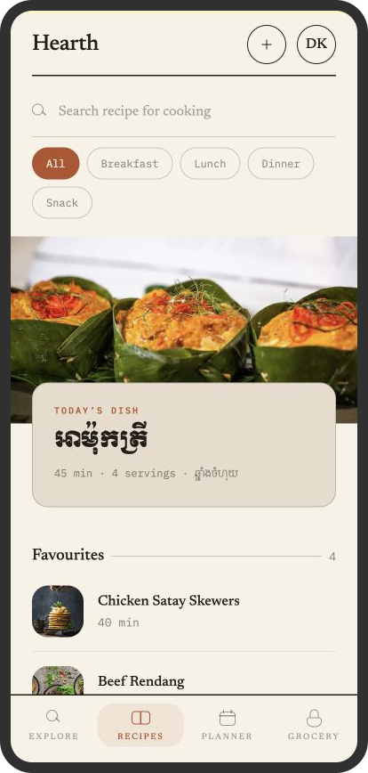
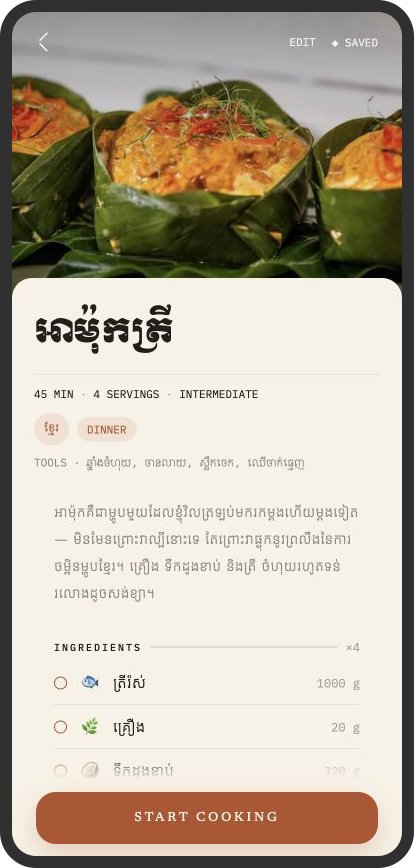
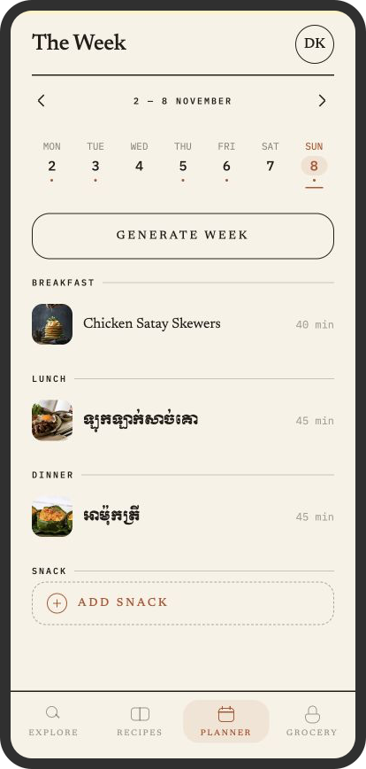
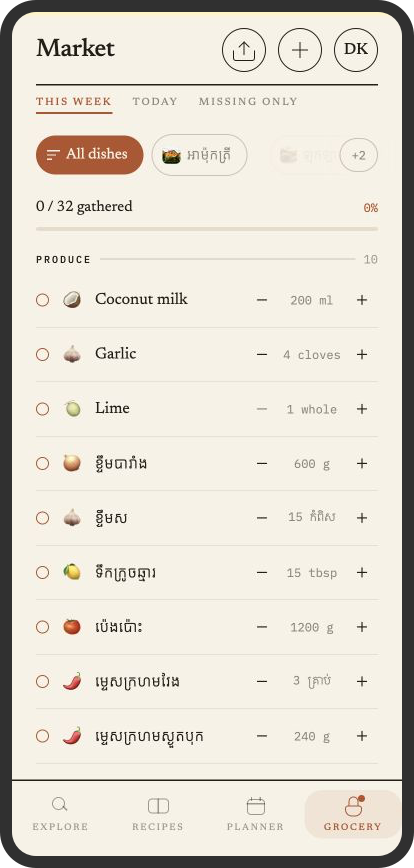
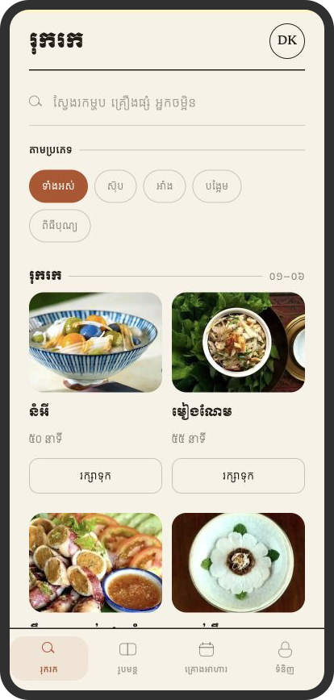

<p align="center">
  
</p>

<p align="center">
  <strong>Your recipes. A week of meals. One market list.</strong>
</p>

<p align="center">
  A personal cookbook with Cambodian roots. Discover Khmer recipes, keep your family favourites,<br />
  plan the week, and take the ingredients straight to the market.
</p>

<p align="center">
  <a href="https://recipe-book-mobile.expo.app"><strong>Try the web app ↗</strong></a>
  &nbsp; · &nbsp;
  <a href="#a-look-inside">Screenshots</a>
  &nbsp; · &nbsp;
  <a href="#run-locally">Run locally</a>
  &nbsp; · &nbsp;
  <a href="https://github.com/nak89/recipe-book-backend">Backend API</a>
</p>

<p align="center">
  
  
  
  
</p>

## A look inside

<!-- Keep these captures of real app screens; see docs/SCREENSHOTS.md. -->
<table>
  <tr>
    <td align="center" width="33%"><br /><strong>Discover</strong><br /><sub>Cambodian dishes to make your own.</sub></td>
    <td align="center" width="33%"><br /><strong>Keep</strong><br /><sub>Your everyday cooking, in one place.</sub></td>
    <td align="center" width="33%"><br /><strong>Cook</strong><br /><sub>Ingredients and a method worth keeping.</sub></td>
  </tr>
  <tr>
    <td align="center"><br /><strong>Plan</strong><br /><sub>Give each day something to look forward to.</sub></td>
    <td align="center"><br /><strong>Gather</strong><br /><sub>A market list that follows your meal plan.</sub></td>
    <td align="center"><br /><strong>Feel at home</strong><br /><sub>English and Khmer, with care for both scripts.</sub></td>
  </tr>
</table>

*Phone-sized captures of the Expo web app, presented in device frames.*

## From “what’s for dinner?” to ready to cook

- **Build your own cookbook.** Add photos, ingredients, tools, and ordered steps. Search your recipes, filter by mealtime, and save favourites.
- **Explore Cambodian cooking.** Browse a shared library of eight dishes adapted from Chef Nak’s recipes, then save a copy to your own collection.
- **Plan the week.** Assign recipes to breakfast, lunch, dinner, or a snack. Generate a dinner-week draft from your cookbook, swap dishes, and save the week together.
- **Shop from the plan.** Matching ingredients add together automatically. Filter the market list by dish or day, adjust weekly quantities, add your own items, and tick off what you’ve gathered.
- **Cook one step at a time.** A dedicated cooking mode keeps the method readable, with optional timers attached to individual steps.
- **Use either language.** Switch the interface between English and Khmer. Your recipes stay in the language you wrote them in.

## Built with

| Part | Technology |
| --- | --- |
| Mobile app | React Native, Expo SDK 58, Expo Router, TypeScript |
| Interaction | React Native Reanimated, Gesture Handler, Expo Haptics |
| Typography | Newsreader and IBM Plex Mono; Kantumruy Pro and Moul for Khmer |
| API | Express and Prisma over PostgreSQL — [separate repository](https://github.com/nak89/recipe-book-backend) |
| Accounts & photos | Supabase Auth and Storage |

The app talks directly to Supabase for sign-in. Recipe data, meal plans, groceries, and photo uploads go through the Express API, with the signed-in user’s access token. The UI shares a central theme and script-aware typography so Khmer content renders correctly even when the interface is in English.

## Run locally

You’ll need Node.js, npm, a Supabase project, and the [backend API](https://github.com/nak89/recipe-book-backend) running first. This is an Expo Go project; no native build is required for local development.

```bash
git clone https://github.com/nak89/recipe-book-mobile.git
cd recipe-book-mobile
npm install
cp .env.example .env
```

Set these values in `.env` using the same Supabase project as the backend:

```dotenv
EXPO_PUBLIC_SUPABASE_URL=https://your-project.supabase.co
EXPO_PUBLIC_SUPABASE_PUBLISHABLE_KEY=your-publishable-key
EXPO_PUBLIC_API_URL=http://localhost:3000
```

For a physical phone, use your computer’s LAN IP for the API URL and keep both devices on the same network. The Android emulator uses `http://10.0.2.2:3000`; the iOS simulator can use `localhost`.

```bash
npm start        # Scan the QR code with Expo Go
npm run ios      # iOS simulator
npm run android  # Android emulator
npm run web      # Browser preview
```

Sign up in the app, then start with the Cambodian library or add your first recipe.

## Project map

```text
src/
├── app/          Routes: Explore, recipes, planner, grocery, profile, cook mode
├── components/   Recipe form, pickers, and shared UI primitives
├── context/      Authentication and shared week state
├── data/         English and Khmer pantry suggestions
├── i18n/         Translations, labels, and numeral formatting
├── lib/          API client, validation, grocery logic, dates, and timers
└── theme/        Colours, typography, spacing, and motion tokens
tests/            Offline unit tests
```

```bash
npx tsc --noEmit  # Type checking
npm run lint     # Linting
npm test         # Offline unit tests; no backend required
```

Unit tests cover the app’s pure logic. Device checks are still needed for gestures, photo uploads, and native text rendering.

## Recipe credits

The shared Cambodian library is adapted from recipes by [Chef Nak](https://chefnak.com). The app includes source attribution; the Khmer adaptations still need a native-reader review. Recipe content and photography belong to their respective creators.
